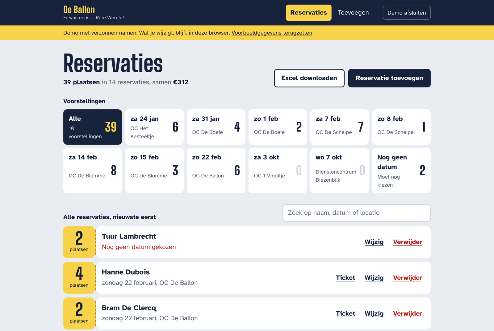

# Toneel-website


The box office of Toneelgroep De Ballon for the play *Er was eens … Rare
Wereld!*: who reserved how many seats for which performance, what that adds up
to, an Excel list for the venues and a printable ticket per reservation.

Written in C# with Blazor WebAssembly, so the whole app runs in the browser and
is hosted for free on GitHub Pages. The data lives in Firebase and is only
reachable after signing in.



The interface is in Dutch; the code and documentation are in English.
[Sign-in page](docs/sign-in.png) · [On a phone](docs/mobile.png)

## Try it

The sign-in page has a **Demo openen** button. The demo uses invented names
that are stored in your own browser only, so anyone can try every feature
without an account and without touching real data.

## Features

- Add, change and remove reservations, with validation on every field
- A person who is added twice for the same performance is merged into one
  reservation instead of listed twice
- One button per performance that shows the seats booked and filters the list
- Search by name, date or location; the totals follow what is on screen
- Excel export (`.xlsx`) of the list that is shown
- A ticket image with date, location and name, generated in the browser
- Sign-in with e-mail and password; the session is kept between visits

## Tech stack

| Area       | Technology                                                     |
| ---------- | -------------------------------------------------------------- |
| UI         | Blazor WebAssembly (.NET 10), Razor components, plain CSS       |
| Logic      | C# class library without dependencies                           |
| Data       | Cloud Firestore through its REST API                            |
| Sign-in    | Firebase Authentication (e-mail and password) through REST      |
| Tests      | xUnit                                                           |
| CI and CD  | GitHub Actions: build, test and deploy to GitHub Pages          |

## Project structure

```text
src/
├── Toneel.Core/           everything that is not user interface
│   ├── Reservations/      model, rules (add, merge, update), search, statistics
│   ├── Schedule/          the play, its performances, Dutch date formatting
│   ├── Export/            .xlsx writer, reservation list, ticket text
│   └── Firebase/          sign-in client and Firestore store (REST)
└── Toneel.Web/            the Blazor WebAssembly app
    ├── Pages/             Overview, AddReservation, EditReservation, SignIn
    ├── Components/        ReservationTicket, PerformanceStrip, ReservationForm, ConfirmDialog
    ├── Services/          session, demo store, browser storage, file downloads
    └── wwwroot/           index.html, CSS, fonts, ticket image, one small JS module
tests/
└── Toneel.Core.Tests/     xUnit tests for Toneel.Core
firestore.rules            who may read and write the data
```

## Run it locally

Requirements: the [.NET 10 SDK](https://dotnet.microsoft.com/download).

```bash
dotnet run --project src/Toneel.Web     # the app; the address is printed in the terminal
dotnet test                             # the tests
```

## Firebase setup

The Firebase settings in `src/Toneel.Web/wwwroot/appsettings.json` are not
secrets: every Firebase web app sends them to the browser. The data is
protected by sign-in and by the rules in [`firestore.rules`](firestore.rules).
Those rules only let in users who are signed in **and** listed in the `admins`
collection.

One-time setup in the [Firebase console](https://console.firebase.google.com/):

1. **Authentication → Sign-in method**: enable *Email/Password*.
2. **Authentication → Users → Add user**: create the account(s) that may use
   the box office. Copy the *User UID* of each.
3. **Authentication → Settings → User actions**: turn off *Enable create
   (sign-up)*, so nobody can register an account themselves.
4. **Firestore Database → Data**: create a collection `admins` and add one
   document per user, with the User UID as document ID (the fields do not
   matter).
5. **Firestore Database → Rules**: paste the contents of `firestore.rules` and
   publish.

## Design decisions

- **Logic in a library, UI on top.** `Toneel.Core` knows nothing about Blazor
  or the browser. That is why the rules (what is a duplicate, how totals are
  counted, what the Excel file contains) can be tested without a browser.
- **One interface for storage.** Pages talk to `IReservationStore`. Firestore,
  the demo's browser storage and the in-memory store of the tests all implement
  it, so the demo runs exactly the same code as the real thing.
- **Firebase through REST instead of the JavaScript SDK.** The whole data flow
  is C#, it is tested with a fake `HttpMessageHandler`, and the page does not
  have to download the SDK.
- **Compatible with the existing data.** Documents keep the field names and
  formats of the first version (`amount`, `date` as "24 januari 2026"), and
  numbers are read whether they were stored as integer, double or text.
- **Rules that do not trust the client.** The security rules check who is
  asking and what a reservation may look like. Checks in the app are for
  convenience; the rules are what protect the data.
- **No HTML built from strings.** The first version put names into
  `innerHTML`, so a name containing markup was executed as code. Razor encodes
  everything by default.
- **A small .xlsx writer instead of a library.** An Excel file is a zip with a
  few XML files. Writing the one sheet we need takes under 200 lines and keeps
  a large dependency out of the download.
- **Dates without culture data.** A WebAssembly app ships only part of the
  culture data, so the Dutch month names are a table in the code and the
  result is the same on every device.

## What changed since the first version

The first version was one HTML page with a script that talked to an open
Firestore database. This version adds sign-in and security rules, separates
logic from UI, has tests and automated deployment, fixes merging of duplicate
reservations (the old code lost the existing number of seats), and replaces
browser `alert`/`confirm` boxes with messages and dialogs in the page.

## Credits

Fonts: [Big Shoulders Display](https://fonts.google.com/specimen/Big+Shoulders+Display)
and [Atkinson Hyperlegible](https://www.brailleinstitute.org/freefont/), both
under the SIL Open Font License.
